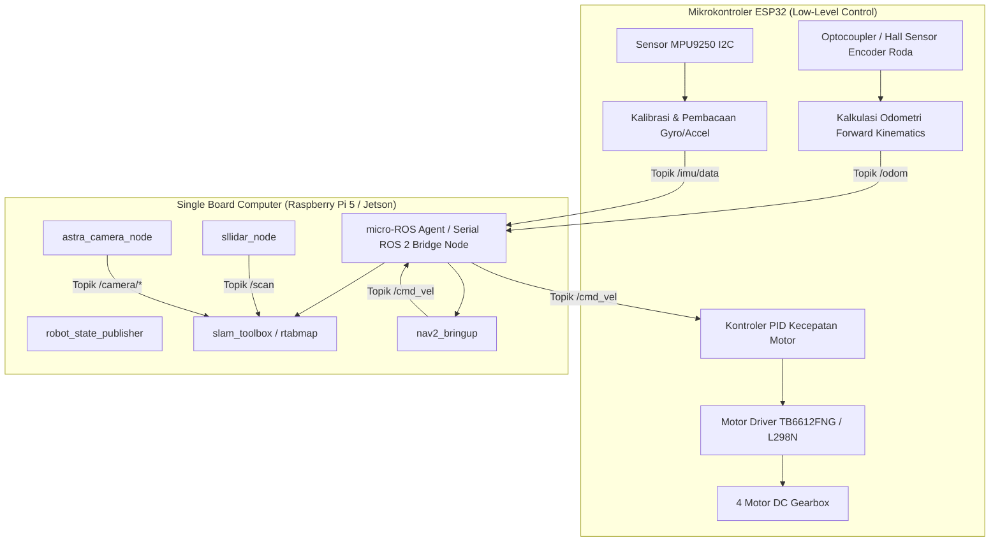

# PANDUAN TEKNIS TRANSISI DARI SIMULASI KE ROBOT FISIK (HARDWARE)

**Penyusun:** Muhammad Bagus Septian  
**Program Studi:** S1 Pendidikan Teknik Mekatronika, Universitas Negeri Yogyakarta  
**Tujuan Dokumen:** Menjadi rujukan teknis implementasi saat robot fisik mulai dirakit, memastikan transisi kode program, konfigurasi parameter ROS 2, dan firmware berlangsung cepat dengan perubahan seminimal mungkin.

---

## 1. Matriks Perbandingan Komponen (Simulasi vs Robot Fisik)

| Sub-Sistem | Implementasi di Simulasi (Gazebo) | Implementasi di Robot Fisik Nyata | Paket / Driver Pengganti |
| :--- | :--- | :--- | :--- |
| **Sistem Komputasi** | Laptop Mahasiswa (Intel/AMD x86_64) | Single Board Computer (SBC ARM64: Raspberry Pi 5 8GB / Jetson Orin Nano) | Ubuntu 22.04 LTS ARM64 + ROS 2 Humble |
| **Komunikasi Low-Level** | Plugin `libgazebo_ros_diff_drive.so` | Mikrokontroler ESP32 via USB Serial | `micro_ros_agent` (Micro-ROS) atau node serial serial bridge |
| **Driver 360° LiDAR** | Plugin `libgazebo_ros_ray_sensor.so` | RPLIDAR A1M8 / RPLIDAR C1 (Slamtec) | Paket ROS 2 `sllidar_ros2` |
| **Driver Kamera RGB-D** | Plugin `libgazebo_ros_camera.so` | Orbbec Astra Pro / Astra Mini / Intel RealSense D435 | Paket `astra_camera` atau `realsense2_camera` |
| **Driver Sensor IMU** | Plugin `libgazebo_ros_imu_sensor.so` | Modul MPU9250 / MPU6050 (I2C ke ESP32 atau SBC) | Diterbitkan via Micro-ROS atau node I2C Linux |
| **Acuan Waktu (Clock)** | `use_sim_time: True` (Clock Gazebo) | `use_sim_time: False` (Hardware System Clock) | Sinkronisasi waktu jaringan NTP/Chrony |
| **Pohon TF Dasar** | Diterbitkan oleh Gazebo plugin | Diterbitkan oleh `robot_state_publisher` + ESP32 odom | `urdf/robot.urdf.xacro` disesuaikan dimensi riil |

---

## 2. Arsitektur Komunikasi Hardware dan Firmware ESP32



### Konfigurasi Micro-ROS pada ESP32:
ESP32 membaca encoder roda pada interupsi *timer* (100 Hz), menghitung kecepatan linier $v$ dan sudut $\omega$:
$$v_L = \frac{2\pi \cdot r \cdot \Delta \text{ticks}_L}{N \cdot \Delta t}, \quad v_R = \frac{2\pi \cdot r \cdot \Delta \text{ticks}_R}{N \cdot \Delta t}$$
$$v = \frac{v_R + v_L}{2}, \quad \omega = \frac{v_R - v_L}{W}$$
Di mana:
- $r$: Jari-jari roda riil ($0.05\text{ m}$).
- $W$: Jarak pisah roda kiri-kanan riil ($0.30\text{ m}$).
- $N$: Jumlah pulsa per putaran (*pulses per revolution* / PPR).

Pesan dipublikasikan ke topik `/odom` bertipe `nav_msgs/msg/Odometry` dan menerima perintah pergerakan dari topik `/cmd_vel` bertipe `geometry_msgs/msg/Twist`.

---

## 3. Langkah Transisi Perangkat Keras Tahap demi Tahap

### Langkah 1: Penyesuaian `robot.urdf.xacro`
1. Ukur dengan jangka sorong dan meteran:
   - Dimensi sasis aktual ($X, Y, Z$).
   - Posisi presisi dudukan baut sensor LiDAR terhadap titik pusat lantai (`base_footprint`).
   - Posisi dan sudut kemiringan fisik lensa kamera RGB-D.
2. Perbarui nilai properti di `robot.urdf.xacro`:
   ```xml
   <xacro:property name="chassis_len" value="PANJANG_RIIL"/>
   <xacro:property name="wheel_separation" value="JARAK_RODA_RIIL"/>
   ```
3. Nonaktifkan atau hapus blok plugin simulator `<gazebo>` pada URDF saat dijalankan di robot nyata, karena topik fisik akan dipublikasikan oleh driver perangkat keras asli.

### Langkah 2: Instalasi Driver Sensor Fisik di SBC
1. **Instalasi Driver RPLIDAR (Slamtec):**
   ```bash
   cd ~/skripsi_ws/src
   git clone https://github.com/Slamtec/sllidar_ros2.git
   # Atur hak akses port USB serial di Linux:
   sudo usermod -a -G dialout $USER
   echo 'KERNEL=="ttyUSB*", ATTRS{idVendor}=="10c4", ATTRS{idProduct}=="ea60", MODE:="0666", SYMLINK+="rplidar"' | sudo tee /etc/udev/rules.d/99-rplidar.rules
   sudo udevadm trigger
   ```
2. **Instalasi Driver Orbbec Astra Pro:**
   ```bash
   cd ~/skripsi_ws/src
   git clone https://github.com/orbbec/astra_camera.git
   # Pasang aturan udev untuk kamera inframerah:
   sudo bash astra_camera/scripts/install_udev_rules.sh
   ```

### Langkah 3: Mengganti Pengaturan Waktu (`use_sim_time`)
Pada robot fisik nyata, **semua berkas konfigurasi parameter dan peluncur wajib diubah ke `use_sim_time: False`**:
1. Di `config/slam_toolbox_params.yaml`:
   `use_sim_time: False`
2. Di `config/nav2_params.yaml`:
   Ganti seluruh parameter `use_sim_time: True` menjadi `use_sim_time: False`.
3. Jalankan peluncur dengan argumen:
   ```bash
   ros2 launch robot_sim slam_fusion.launch.py use_sim_time:=false
   ```

---

## 4. Kalibrasi Parameter Kritis di Lingkungan Nyata

### A. Kalibrasi Odometri Roda (Odometry Tuning)
Pada lantai nyata, terjadi deformasi ban karet dan slip saat robot berbelok:
1. **Uji Maju Garis Lurus (10 Meter):**
   - Beri perintah robot maju 5.0 meter di atas lantai berubin dengan pita ukur.
   - Bandingkan posisi $X$ di `/odom` dengan meteran fisik.
   - Sesuaikan konstanta `wheel_radius_correction_factor` jika terdapat deviasi linier.
2. **Uji Putar di Tempat (360 Derajat):**
   - Beri perintah robot berputar 10 putaran penuh ($20\pi\text{ rad}$).
   - Amati apakah orientasi robot di RViz tepat kembali ke sudut awal.
   - Jika orientasi di RViz berputar lebih cepat atau lambat dari robot asli, sesuaikan parameter jarak roda `wheel_separation` pada firmware ESP32.

### B. Matriks Kovarian (Covariance Matrix Tuning)
Pada simulasi, derau sensor diatur matematis. Pada robot fisik:
- Derau roda berbanding lurus dengan kehalusan lantai.
- Perbarui matriks kovarian odometri di pesan `/odom` (`pose.covariance` dan `twist.covariance`):
  - Jika roda sering slip di lantai licin, naikkan nilai kovarian yaw ($\sigma_{\text{yaw}}^2 = 0.05$).
  - Hal ini memaksa `slam_toolbox` dan `rtabmap` lebih mempercayai scan matching LiDAR daripada odometri roda saat terjadi perbedaan estimasi.

---

## 5. Analisis Beban Komputasi dan Pemilihan Single Board Computer (SBC)

Berdasarkan hasil uji beban simulasi (Fase 6):
- **Skenario 1: LiDAR Saja (`slam_toolbox`)**
  - Beban CPU: $\approx 15 - 25\%$, RAM: $\approx 350\text{ MB}$.
  - *Dapat dijalankan sangat mulus pada Raspberry Pi 4 4GB atau Raspberry Pi 5.*
- **Skenario 2: Fusi Sensor RTAB-Map Penuh (LiDAR + RGB-D 30 FPS + Point Cloud 3D)**
  - Beban CPU: $\approx 50 - 75\%$, RAM: $\approx 1.5 - 2.5\text{ GB}$.
  - Rekomendasi:
    1. **Raspberry Pi 5 (RAM 8 GB) + Active Cooler:** Pilihan paling ekonomis dan ketersediaan tinggi di pasar lokal Yogyakarta/Indonesia. Mampu menjalankan RTAB-Map dengan resolusi kamera RGB-D $640 \times 480$ pada laju $15 - 20\text{ FPS}$ (disarankan menurunkan laju deteksi fitur ke 10 Hz agar suhu stabil).
    2. **NVIDIA Jetson Orin Nano (8 GB):** Pilihan ideal untuk akselerasi grafis hardware CUDA jika mahasiswa ingin menambahkan fitur AI / deteksi objek visual di masa depan, namun memiliki harga modul lebih tinggi.

---

## 6. Prosedur Uji Coba Lapangan Hari Pertama (First-Day Checklist)

1. [ ] Baterai LiPo / Aki 12V robot fisik terisi penuh (tegangan $\ge 12.2\text{ V}$).
2. [ ] SBC terhubung dengan aman ke jaringan Wi-Fi laboratorium dengan alamat IP statis.
3. [ ] Jam sistem SBC tersinkronisasi via Chrony/NTP dengan laptop operator.
4. [ ] Uji koneksi topik serial ESP32: `/odom` bertambah saat roda digerakkan manual dengan tangan.
5. [ ] Uji putaran motor: `/cmd_vel` memutar roda ke arah depan saat ditekan tombol `W` di `teleop_wasd.py`.
6. [ ] Uji sapuan LiDAR fisik di RViz2: titik-titik laser merah membentuk denah ruangan laboratorium secara tepat.
7. [ ] Uji stream citra dan depth kamera fisik: tidak ada frame yang terpotong (*no dropped frames*).
8. [ ] Jalankan pemetaan 2D `slam_toolbox` perlahan mengitari laboratorium UNY.
9. [ ] Simpan peta perdana laboratorium: `ros2 run nav2_map_server map_saver_cli -f lab_uny_map`.
