# LABSHEET 0: DARI CITRA 2D KE CITRA KEDALAMAN — MENERAPKAN OPENCV PADA KAMERA RGB-D ROBOT

**Mata Kuliah:** Penginderaan Visual Robot  
**Program Studi:** S1 Pendidikan Teknik Mekatronika, Universitas Negeri Yogyakarta  
**Penyusun:** Muhammad Bagus Septian  
**Alokasi Waktu:** 3 x 50 Menit (1 Pertemuan Praktikum)  
**Prasyarat:** Materi pengolahan citra dengan OpenCV dan Python (buku *Langkah Mudah Pemrograman OpenCV & Python*, Abdul Kadir, Bab 4–10)

> Versi cetak lengkap dengan gambar: `Labsheet_0_Jembatan_OpenCV_ke_Kamera_RGBD.docx`. Semua gambar ada di folder `gambar_labsheet0/` dan diambil langsung dari simulasi.

---

## 1. Tujuan Pembelajaran
Setelah menyelesaikan praktikum ini, mahasiswa diharapkan mampu:
1. Menjelaskan perbedaan isi piksel citra RGB dan citra kedalaman (*depth*).
2. Membaca nilai jarak dari piksel citra kedalaman kamera RGB-D robot.
3. Menerapkan histogram, filter median, citra biner, dan operasi morfologi yang sudah dipelajari pada citra kedalaman.
4. Mendeteksi titik fitur pada citra RGB dan menjelaskan hubungannya dengan *Visual SLAM*.
5. Menghitung koordinat titik 3D dari sebuah piksel citra kedalaman dan memverifikasinya dengan data *point cloud* kamera.

---

## 2. Alat dan Bahan
1. Laptop/komputer dengan Ubuntu 22.04 (native atau WSL2) yang sudah terpasang sesuai *Panduan Instalasi untuk Mahasiswa*.
2. ROS 2 Humble, Gazebo, dan paket `robot_sim`.
3. Skrip praktikum `labsheet0_rgbd_opencv.py` (sudah ada di paket `robot_sim`).
4. Kalkulator.
5. Buku *Langkah Mudah Pemrograman OpenCV & Python* sebagai rujukan materi sebelumnya.

---

## 3. Dasar Teori Singkat

### A. Apa yang sama dan apa yang baru
Pada praktikum sebelumnya, citra berasal dari berkas gambar atau *webcam*. Setiap piksel citra berwarna berisi tiga angka 0–255 (B, G, R). Kamera RGB-D menghasilkan **dua citra sekaligus**:

| | Citra RGB | Citra kedalaman (*depth*) |
| :--- | :--- | :--- |
| Isi piksel | 3 angka 0–255 (B, G, R) | 1 angka pecahan: **jarak dalam meter** |
| Tipe data | `uint8` | `float32` (encoding `32FC1`) |
| Piksel kosong | Tidak ada | `NaN`/`inf` jika benda lebih dekat dari 0,3 m atau lebih jauh dari 6,0 m |
| Topik ROS 2 | `/camera/image_raw` | `/camera/depth/image_raw` |

Karena citra kedalaman tetap berupa **matriks**, hampir semua operasi OpenCV yang sudah dipelajari dapat dipakai langsung.

### B. Hubungan materi buku dengan praktikum ini

| Materi buku | Dipakai untuk | Mode skrip |
| :--- | :--- | :--- |
| Bab 4: citra sebagai matriks piksel | Membaca ukuran, tipe data, dan nilai piksel *depth* | `info`, `depth` |
| Bab 5: histogram | Melihat sebaran jarak benda di depan robot | `histogram` |
| Bab 7: filter dan pengurangan derau | Mengurangi derau citra *depth* dengan filter median | `filter` |
| Bab 4 & 8: citra biner dan morfologi | Mendeteksi rintangan yang lebih dekat dari batas jarak | `obstacle` |
| Bab 9: fitur objek | Mendeteksi titik fitur (sudut) yang dipakai RTAB-Map | `features` |
| (baru) model kamera *pinhole* | Mengubah piksel menjadi titik 3D | `point` |

### C. Dari piksel ke titik 3D
Kamera dimodelkan sebagai kamera lubang jarum (*pinhole*). Setiap titik benda dipetakan ke satu piksel (u, v) pada bidang citra. Kamera RGB-D juga mengukur jaraknya ke depan, Z. Dari ketiga nilai itu posisi benda di ruang 3D dapat dihitung kembali:

$$X = \frac{(u - c_x)\,Z}{f_x}, \qquad Y = \frac{(v - c_y)\,Z}{f_y}$$

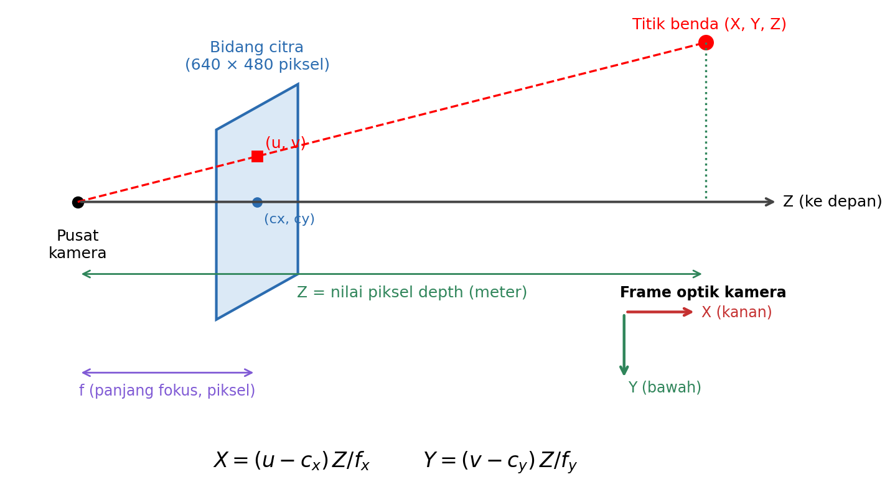

- $u$ = kolom piksel (0 di kiri), $v$ = baris piksel (0 di atas).
- $f_x, f_y$ = panjang fokus dalam satuan piksel; $c_x, c_y$ = titik pusat citra. Keempatnya dibaca dari topik `/camera/camera_info`. Pada kamera simulasi ini $f_x = f_y = 337{,}2$, $c_x = 320{,}5$, $c_y = 240{,}5$.
- Hasilnya dinyatakan dalam **frame optik kamera**: X positif ke kanan, Y positif ke **bawah**, Z positif ke depan.

**Contoh perhitungan.** Piksel (u = 200, v = 220) memiliki nilai *depth* Z = 5,230 m (papan tulis):

- X = (200 − 320,5) × 5,230 / 337,2 = **−1,869 m** → 1,87 m di sebelah **kiri** sumbu kamera.
- Y = (220 − 240,5) × 5,230 / 337,2 = **−0,318 m** → 0,32 m di **atas** sumbu kamera.

Rumus yang sama dipakai untuk setiap piksel sehingga terbentuk *point cloud* (topik `/camera/points`) yang nanti diolah RTAB-Map pada Labsheet 2.

---

## 4. Langkah Kerja

Praktikum memakai Dunia C (ruang kelas). Robot ditempatkan di tiga posisi tetap agar hasil setiap mahasiswa dapat dibandingkan.

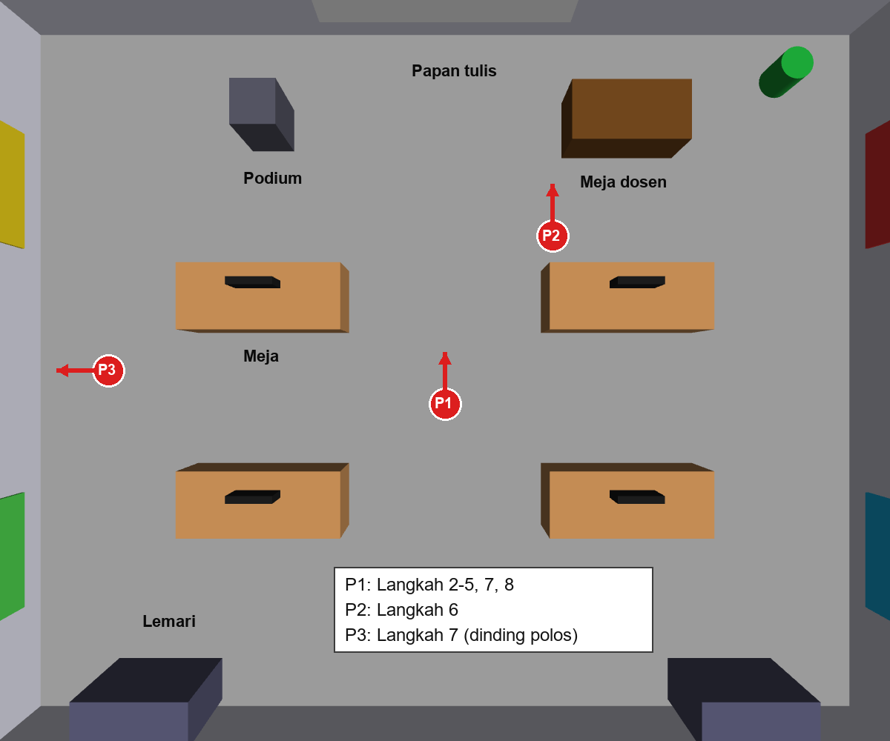

| Posisi | Perintah peluncur | Dipakai pada |
| :---: | :--- | :--- |
| P1 | `ros2 launch robot_sim sim.launch.py world:=world_c x:=0.0 y:=-0.5 yaw:=1.5708` | Langkah 2–5, 7 (no. 1), 8 |
| P2 | `ros2 launch robot_sim sim.launch.py world:=world_c x:=1.6 y:=2.0 yaw:=1.5708` | Langkah 6 |
| P3 | `ros2 launch robot_sim sim.launch.py world:=world_c x:=-5.0 y:=0.0 yaw:=3.1416` | Langkah 7 (no. 2) |

Untuk pindah posisi, hentikan simulasi dengan `Ctrl + C` lalu jalankan perintah posisi berikutnya.

> Jika muncul `No executable found`, paket `robot_sim` belum di-*build* ulang:
> `cd ~/skripsi_ws && colcon build --symlink-install --packages-select robot_sim && source install/setup.bash`
>
> Semua gambar hasil disimpan di `~/labsheet0_hasil/`. Dari terminal Ubuntu, buka foldernya dengan `explorer.exe ~/labsheet0_hasil`.

### Langkah 1: Menjalankan Simulasi di Posisi P1
1. Terminal pertama:
   ```bash
   source ~/skripsi_ws/install/setup.bash
   ros2 launch robot_sim sim.launch.py world:=world_c x:=0.0 y:=-0.5 yaw:=1.5708
   ```
2. Terminal kedua, pastikan topik kamera aktif:
   ```bash
   ros2 topic list | grep camera
   ros2 topic hz /camera/depth/image_raw
   ```

### Langkah 2: Citra sebagai Matriks (Bab 4)
```bash
ros2 run robot_sim labsheet0_rgbd_opencv.py --mode info
```
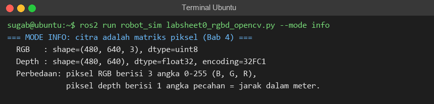
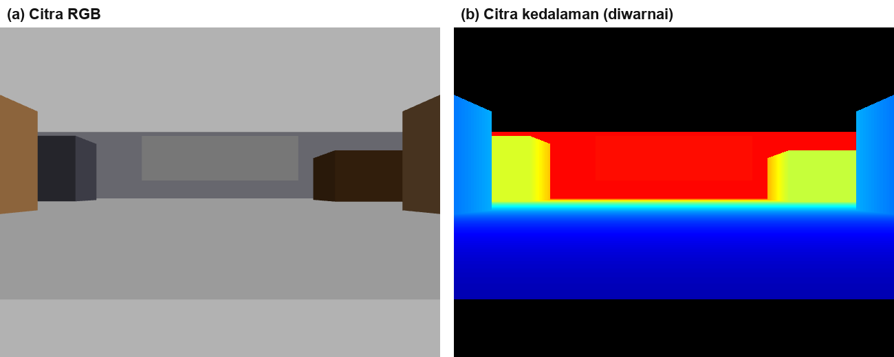

Pada citra kedalaman berwarna, biru berarti dekat, merah berarti jauh, dan **hitam berarti tidak valid** (di luar jangkauan 0,3–6,0 m). Isi Tabel 0.1.

### Langkah 3: Membaca Nilai Jarak dari Piksel (Bab 4)
```bash
ros2 run robot_sim labsheet0_rgbd_opencv.py --mode depth
```
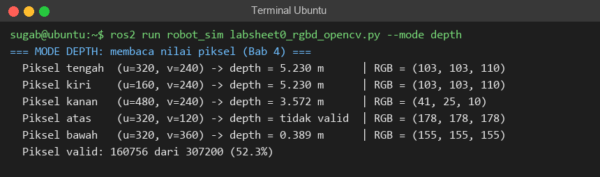
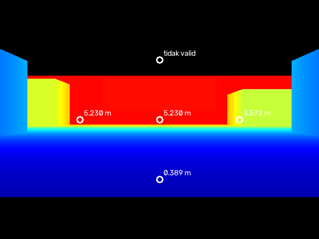

Isi Tabel 0.2. Perhatikan bahwa piksel bawah (lantai) dan piksel kanan (meja dosen) memiliki warna RGB berbeda dan jarak berbeda.

### Langkah 4: Histogram Jarak (Bab 5)
```bash
ros2 run robot_sim labsheet0_rgbd_opencv.py --mode histogram
```
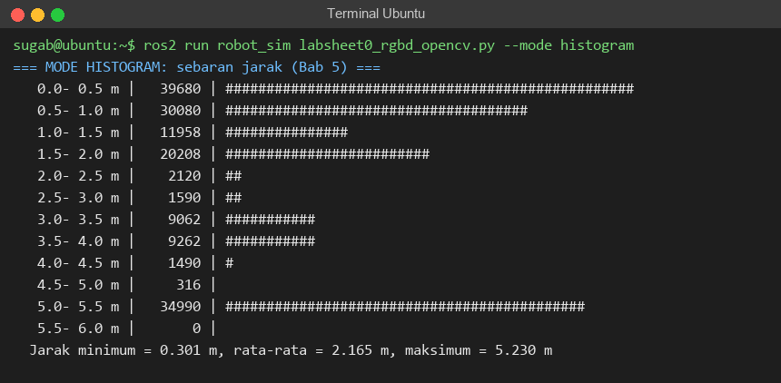
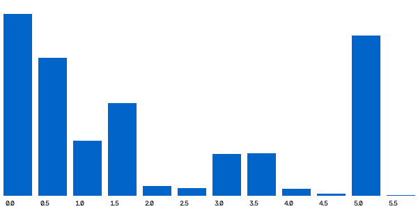

Setiap batang menunjukkan jumlah piksel pada rentang jarak tertentu. Kaitkan puncak histogram dengan benda pada Gambar 0.3.

### Langkah 5: Filter Median pada Citra Kedalaman (Bab 7)
1. Tanpa derau tambahan:
   ```bash
   ros2 run robot_sim labsheet0_rgbd_opencv.py --mode filter --derau 0
   ```
2. Dengan derau Gaussian 10 mm (menyerupai kamera fisik), kernel 5 lalu kernel 3:
   ```bash
   ros2 run robot_sim labsheet0_rgbd_opencv.py --mode filter --derau 0.01 --kernel 5
   ros2 run robot_sim labsheet0_rgbd_opencv.py --mode filter --derau 0.01 --kernel 3
   ```
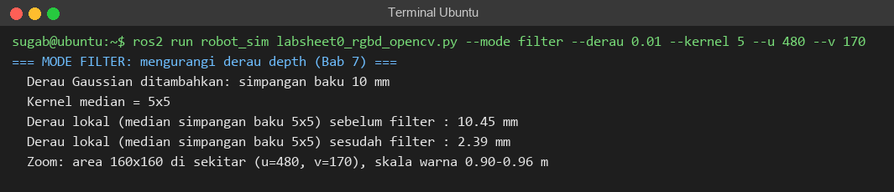
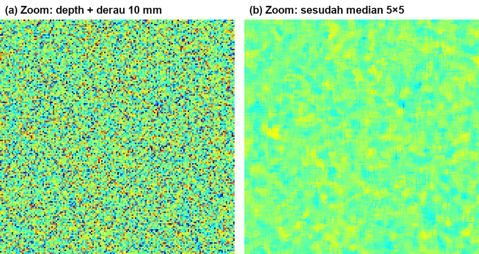

Berkas `filter_zoom_sebelum.png` dan `filter_zoom_sesudah.png` memperbesar area 160×160 piksel dengan skala warna ±30 mm agar derau terlihat. Isi Tabel 0.3.

### Langkah 6: Deteksi Rintangan dengan Citra Biner dan Morfologi (Bab 4 & 8)
1. Hentikan simulasi, jalankan ulang di **posisi P2** (meja dosen di kanan depan robot).
2. Tanpa membuang lantai:
   ```bash
   ros2 run robot_sim labsheet0_rgbd_opencv.py --mode obstacle --jarak 1.0 --dengan-lantai
   ```
3. Dengan lantai dibuang:
   ```bash
   ros2 run robot_sim labsheet0_rgbd_opencv.py --mode obstacle --jarak 1.0
   ```
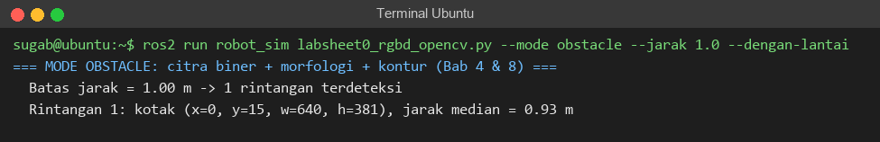
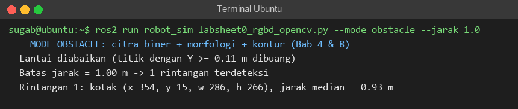
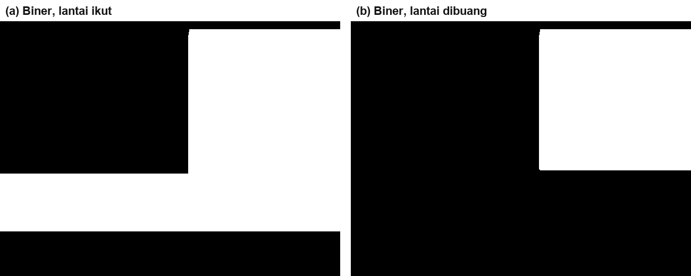
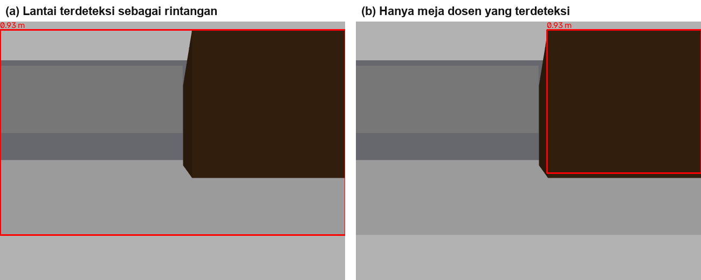

Isi Tabel 0.4.

### Langkah 7: Titik Fitur untuk Visual SLAM (Bab 9)
1. Di posisi **P1**: `ros2 run robot_sim labsheet0_rgbd_opencv.py --mode features`
2. Jalankan ulang simulasi di posisi **P3** (menghadap dinding polos), lalu jalankan perintah yang sama.

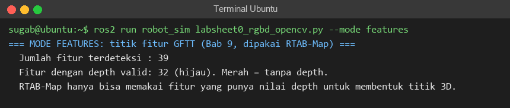

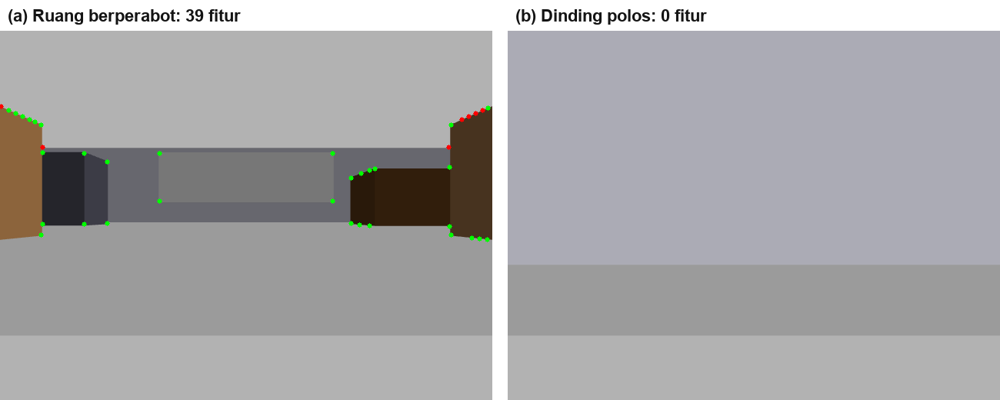

Titik hijau memiliki nilai *depth*, titik merah tidak. Isi Tabel 0.5.

### Langkah 8: Dari Piksel ke Titik 3D
Kembali ke **posisi P1**.

1. Jalankan mode `point` tanpa memilih piksel (otomatis piksel pusat). Catat $f_x, f_y, c_x, c_y$ dari baris pertama keluaran.
   ```bash
   ros2 run robot_sim labsheet0_rgbd_opencv.py --mode point
   ```
2. Jalankan untuk dua piksel yang sudah ditentukan dan satu piksel pilihan sendiri. Gunakan Gambar 0.4 untuk memilih piksel yang **tidak hitam**.
   ```bash
   ros2 run robot_sim labsheet0_rgbd_opencv.py --mode point --u 200 --v 220
   ros2 run robot_sim labsheet0_rgbd_opencv.py --mode point --u 480 --v 300
   ros2 run robot_sim labsheet0_rgbd_opencv.py --mode point --u ... --v ...
   ```
   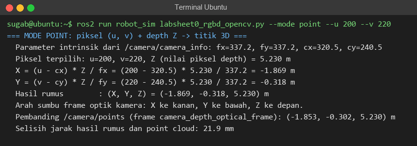
   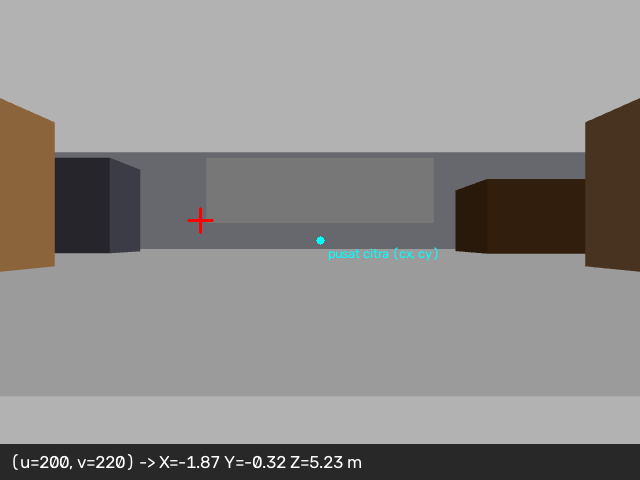
3. **Sebelum melihat hasil skrip**, hitung X dan Y dengan kalkulator memakai rumus bagian 3C dan nilai Z dari keluaran. Tulis di kolom "Hitungan Manual" Tabel 0.6.
4. Salin hasil skrip dan nilai pembanding dari `/camera/points` ke Tabel 0.6. Skrip mengambil titik pada indeks (u, v) dari *point cloud* yang dihasilkan kamera sendiri, sehingga dapat dipakai untuk memeriksa hitungan.
5. Tafsirkan tanda dan besar setiap koordinat: X negatif berarti di kiri, Y positif berarti di bawah sumbu kamera. Bandingkan nilai Y piksel (480, 300) dengan tinggi kamera dari lantai (0,14 m).

---

## 5. Lembar Pengamatan Mahasiswa

### Tabel 0.1: Karakteristik Citra RGB dan Citra Kedalaman
| Parameter | Citra RGB | Citra Kedalaman |
| :--- | :--- | :--- |
| Ukuran (baris × kolom) | | |
| Jumlah kanal | | |
| Tipe data | | |
| Satuan nilai piksel | | |

### Tabel 0.2: Nilai Jarak pada Piksel Tertentu (Posisi P1)
| Posisi Piksel | (u, v) | Jarak (m) | Nilai RGB | Benda yang Terlihat |
| :--- | :---: | :---: | :---: | :--- |
| Tengah | | | | |
| Kiri | | | | |
| Kanan | | | | |
| Atas | | | | |
| Bawah | | | | |

Persentase piksel valid: .......... %

### Tabel 0.3: Pengaruh Filter Median terhadap Derau
| Percobaan | Derau Tambahan | Kernel | Derau Sebelum (mm) | Derau Sesudah (mm) |
| :--- | :---: | :---: | :---: | :---: |
| 1 | 0 mm | 5×5 | | |
| 2 | 10 mm | 5×5 | | |
| 3 | 10 mm | 3×3 | | |

### Tabel 0.4: Deteksi Rintangan (Posisi P2)
| Percobaan | Jumlah Rintangan | Posisi Kotak (x, y, w, h) | Jarak Median (m) | Benda Sebenarnya |
| :--- | :---: | :--- | :---: | :--- |
| Dengan lantai | | | | |
| Lantai dibuang | | | | |

### Tabel 0.5: Titik Fitur
| Posisi | Arah Kamera | Jumlah Fitur | Fitur dengan Depth Valid |
| :---: | :--- | :---: | :---: |
| P1 | Ruang berperabot | | |
| P3 | Dinding polos | | |

### Tabel 0.6: Dari Piksel ke Titik 3D (Posisi P1)
$f_x$ = .......... $f_y$ = .......... $c_x$ = .......... $c_y$ = ..........

| (u, v) | Z (m) | X Manual (m) | Y Manual (m) | X, Y Skrip (m) | Pembanding `/camera/points` (X, Y, Z) | Selisih (mm) | Benda |
| :---: | :---: | :---: | :---: | :---: | :---: | :---: | :--- |
| (200, 220) | | | | | | | |
| (480, 300) | | | | | | | |
| (...., ....) | | | | | | | |

---

## 6. Pertanyaan Analisis dan Diskusi
1. Mengapa sebagian piksel citra kedalaman tidak valid (hitam), padahal piksel citra RGB pada posisi yang sama tetap berisi warna? Lihat bagian atas dan bawah Gambar 0.3.
2. Pada Langkah 5, filter median hampir tidak mengubah citra kedalaman asli simulator. Apa artinya bagi perbedaan antara simulasi dan kamera fisik (*sim-to-real gap*)? Kernel mana yang lebih kuat mengurangi derau, dan apa kerugiannya pada tepi benda?
3. Pada Langkah 6, mengapa lantai ikut terdeteksi sebagai rintangan? Jelaskan cara skrip membuang lantai dengan memakai nilai Y dan tinggi kamera.
4. Mengapa jumlah titik fitur di depan dinding polos jauh lebih sedikit daripada di ruang berperabot? Apa akibatnya bagi *Visual SLAM* (Labsheet 2)?
5. Pada Langkah 8, nilai Y piksel (480, 300) hampir sama dengan tinggi kamera dari lantai. Apa artinya? Bagaimana sifat ini dapat dipakai untuk memisahkan lantai dari rintangan?
6. Hasil rumus dan nilai `/camera/points` berbeda beberapa milimeter, dan selisihnya makin besar untuk benda yang makin jauh. Hitung berapa meter yang diwakili oleh selisih satu piksel pada Z = 5,23 m ($Z/f_x$), lalu jelaskan dari mana selisih itu berasal.
7. LiDAR 2D hanya memindai satu bidang mendatar. Berdasarkan Langkah 6 dan 8, benda apa yang dapat dilihat kamera RGB-D tetapi terlewat oleh LiDAR?

---

## 7. Rubrik Penilaian Praktikum
| Aspek Penilaian | Skor Maksimal | Kriteria Pencapaian |
| :--- | :---: | :--- |
| **Persiapan & Menjalankan Skrip** | 10 | Mampu menjalankan simulasi di posisi P1–P3 dan semua mode skrip tanpa kendala. |
| **Pengisian Tabel 0.1–0.5** | 30 | Tabel terisi lengkap dan sesuai keluaran skrip serta gambar hasil. |
| **Perhitungan Titik 3D (Tabel 0.6)** | 25 | Hitungan manual X dan Y benar, tanda (+/−) ditafsirkan dengan tepat, dan diverifikasi dengan `/camera/points`. |
| **Jawaban Pertanyaan Diskusi** | 35 | Mampu mengaitkan operasi OpenCV dengan pemetaan, *Visual SLAM*, dan perbedaan simulasi dengan kamera fisik. |
| **Total Skor** | **100** | |
